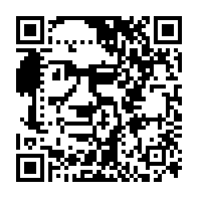

# qart-rsc

[](https://crates.io/crates/qart-rsc)
[](https://docs.rs/qart-rsc)
[](https://github.com/ibotty/qart-rsc/actions/workflows/ci.yml)
[](https://github.com/ibotty/qart-rsc/actions/workflows/zizmor.yml)
[](LICENSE)

Embeds an image in a QR code that still scans. Rust port of the `qart`
package of [rsc/qr](https://github.com/rsc/qr), described in Russ Cox's
[QR Codes as Art](https://research.swtch.com/qart).

The code decodes to the URL, a `#` and a long run of digits that the encoder
picks to draw the image. A URL with a fragment of its own is rejected. Use
`Options::query_param` (`--param KEY` in the example) to put the digits in a
query parameter before the fragment instead, for example
`https://example.com/?k=<digits>#top`. The server receives the parameter, so
it must ignore it.



```rust
use qart_rsc::{Options, encode};

let img = image::open("tests/pjw.png")?;
let opts = Options::new("https://research.swtch.com/qart");
let q = encode(&img, &opts)?;
q.to_image(8, 4).save("out.png")?;
q.control_image(8, 4).save("control.png")?;
println!("{}", q.text());
```

Command line:

```sh
cargo run --example qart -- tests/pjw.png https://research.swtch.com/qart -o out.png
```

## Credits

Based on [rsc/qr](https://github.com/rsc/qr) by Russ Cox. Licensed under the
same BSD-3-Clause license as the original, see [LICENSE](LICENSE).
`tests/pjw.png` is from the original repository.
